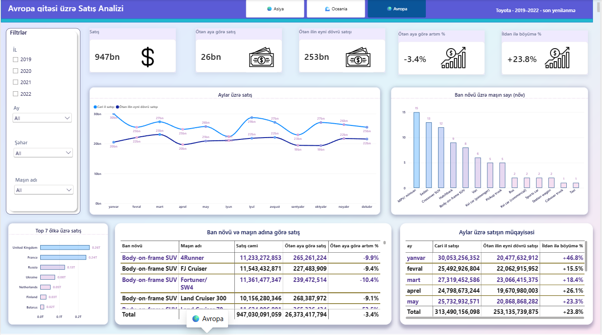
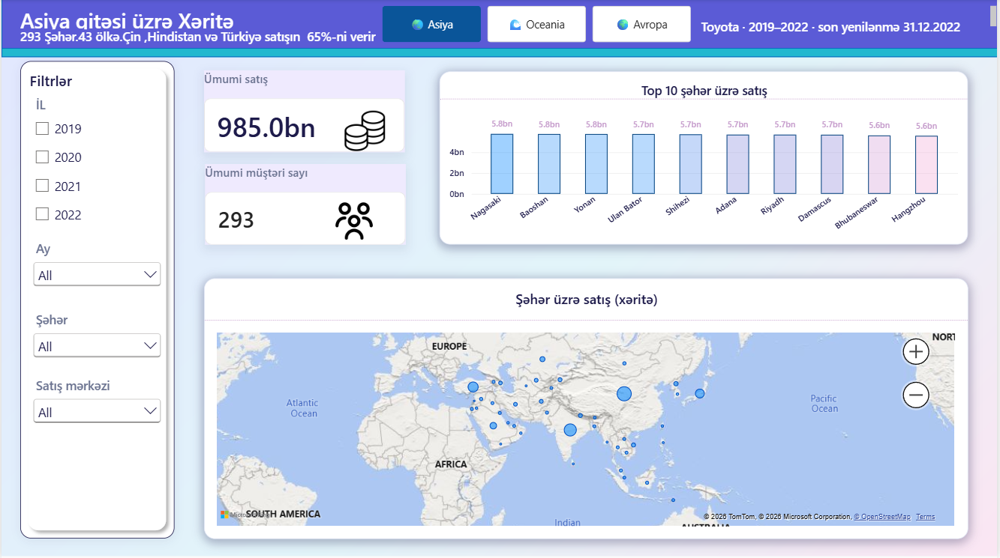
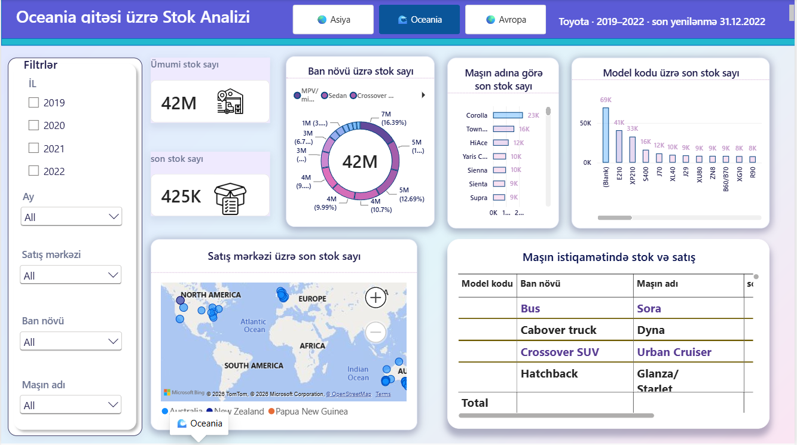
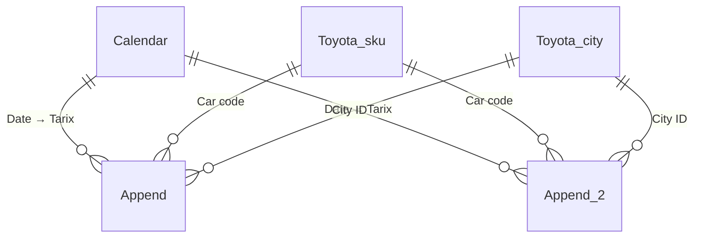

# Toyota Sales Analysis: Power BI Dashboard

🇬🇧 English · [🇦🇿 Azərbaycanca](README.az.md)

Analysis of Toyota vehicle sales and stock for 2019–2022 by continent, country, city and body type. The report has three pages, each with icon navigation buttons at the top.

## Key results

| Metric | Value |
|---|---:|
| Total sales (2019–2022) | **3.70 trn** |
| Sales transactions | **672,765** |
| Cities / countries | **1,097 / 157** |
| Models (codes) | **56 (83)** |

| Year | Sales | YoY growth |
|---|---:|---:|
| 2019 | 715.9 bn | n/a |
| 2020 | 724.0 bn | +1.1% |
| 2021 | 963.3 bn | **+33.0%** |
| 2022 | 1,298.7 bn | **+34.8%** |

### Insights

1. **Growth started in 2021.** Sales were almost flat in 2019–2020 (+1.1%) and then grew by about a third in each of 2021 and 2022.
2. **Continents:** the Americas generate **31.5%** of sales, Asia **26.6%**, Europe **25.6%**. Oceania (8.8%) and Africa (7.6%) together are less than a sixth.
3. **Countries:** the USA leads with **539.9 bn** (14.6%), followed by China (294.5 bn), Australia (293.6 bn), the UK (260.6 bn) and Canada (253.2 bn).
4. **Body type:** MPV/minivan (**18.0%**), Sedan (15.4%) and Crossover SUV (13.5%) are the top three.
5. **Best model:** Corolla, with 206.8 bn (5.6%), sells more than twice as much as any other model (~89 bn).
6. **Sales are evenly spread across cities.** The best city has only 0.16% of sales, so the business does not depend on one city.
7. **Seasonality is weak.** Monthly differences are about ±6%.
8. **Sales types (A, B, C)** are balanced at roughly a third each.

## Dashboard pages

### 🌏 Asia: sales map
Sales by city on a map, Top 10 cities, total sales and customer count cards.

### 🌊 Oceania: stock analysis
Total and latest stock, share by body type (donut), latest stock by car and model, map of sales centres.

### 🌍 Europe: sales analysis
Sales, same period last year, month-over-month change and growth rates, monthly comparison, sales by body type and country.

## Data model

A star schema: two fact tables (`Append` for sales, `Append (2)` for daily stock) share three dimensions (`Toyota_sku`, `Toyota_city`, `Calendar`).

### DAX measures (11)

Measures are grouped into display folders. Full code and explanations: [docs/DAX_measures.md](docs/DAX_measures.md)

| Folder | Measures |
|---|---|
| **General** | Total sales, customer count, number of car types |
| **Oceania (stock)** | Total stock, latest stock |
| **Europe (comparison)** | Current year sales, same period last year, YoY growth %, current month sales, previous month sales, MoM growth % |

Time comparisons use the **latest date in the selection**, so they are correct even when no year or month is selected.

## Issues found and fixed during the review

| Problem | Fix |
|---|---|
| Months were sorted alphabetically (April, August, December…) | Sorted by month number (`Ayno`) |
| "YoY growth" showed 54% when no year was selected (all years vs the previous total) | Compares the latest year with the previous one: **34.8%** |
| "Previous month" measures made no sense without a month selection | Compare the latest month with the month before |
| "Latest stock" summed only the last day's records | Takes each car's own last recorded stock |
| Cards and tables summed a column directly instead of using measures | Bound to measures |
| Two identical "City" slicers | The second became a "Sales centre" slicer |
| City chart crowded 293 cities | Limited to the Top 10 |
| The "buttons" were a static picture | Replaced with the built-in page navigator |

## How to open

1. Install [Power BI Desktop](https://powerbi.microsoft.com/desktop/) (free, Windows).
2. Download and open `dashboard/Toyota_Dashboard.pbix`. The data is embedded in the file, so no extra setup is needed.

## Skills demonstrated

Power BI · DAX (time intelligence, `LASTNONBLANK`, `SAMEPERIODLASTYEAR`) · star-schema modelling · dashboard design and navigation · data-quality review of an existing report

## Author

**Alyaz Cabbarova**: [GitHub](https://github.com/alyazcbbrv-byte) · [LinkedIn](https://www.linkedin.com/in/alyaz-cabbarova-450a6140b) · [alyazcbbrv@gmail.com](mailto:alyazcbbrv@gmail.com)

More projects: [Amazon sales analysis](https://github.com/alyazcbbrv-byte/amazon-sales-analysis) · [Retail chain: sales vs plan and churn](https://github.com/alyazcbbrv-byte/retail-sales-vs-plan-powerbi)

## License

[MIT](LICENSE) for the report and documentation. The source data is educational sample data from a training course.
