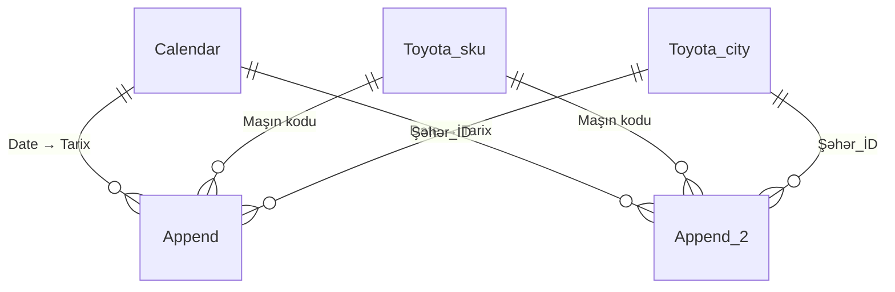

# Toyota Satış Analizi: Power BI Dashboard


Toyota maşınlarının 2019–2022-ci illər üzrə satış və stok məlumatlarının qitələr, ölkələr, şəhərlər və maşın növləri üzrə analizi. Hesabat 3 səhifədən ibarətdir, hər səhifənin yuxarısında ikonlu keçid düymələri var.


## Əsas nəticələr

| Göstərici | Dəyər |
|---|---:|
| Ümumi satış (2019–2022) | **3.70 trln** |
| Satış əməliyyatı | **672 765** |
| Şəhər / ölkə sayı | **1 097 / 157** |
| Maşın modeli (kod) | **56 (83)** |

**İllər üzrə satış**

| İl | Satış | İllik artım |
|---|---:|---:|
| 2019 | 715.9 mlrd | — |
| 2020 | 724.0 mlrd | +1.1% |
| 2021 | 963.3 mlrd | **+33.0%** |
| 2022 | 1 298.7 mlrd | **+34.8%** |

**Müşahidələr**

1. **Artım 2021-dən başlayıb.** 2019–2020-də satış demək olar ki, dəyişməyib (+1.1%). 2021 və 2022-də hər il təxminən üçdə bir artıb.
2. **Qitələr:** Amerika satışın **31.5%**-ni, Asiya **26.6%**-ni, Avropa **25.6%**-ni verir. Oceania (8.8%) və Afrika (7.6%) birlikdə altıda birdən azdır.
3. **Ölkələr:** ABŞ **539.9 mlrd** ilə birinci yerdədir (14.6%). Sonra Çin (294.5 mlrd), Avstraliya (293.6 mlrd), Böyük Britaniya (260.6 mlrd) və Kanada (253.2 mlrd) gəlir.
4. **Ban növü:** MPV/minivan (**18.0%**), Sedan (15.4%) və Crossover SUV (13.5%) ən çox satılan üç növdür.
5. **Ən yaxşı model:** Corolla 206.8 mlrd ilə (5.6%) digər modellərdən (~89 mlrd) 2 dəfədən çox öndədir.
6. **Satış şəhərlər üzrə bərabər bölünüb.** Ən yaxşı şəhərin payı cəmi 0.16%-dir, yəni biznes bir şəhərdən asılı deyil.
7. **Mövsümilik zəifdir.** Aylar arasındakı fərq təxminən ±6%-dir: ən yüksək mart (326 mlrd), ən aşağı fevral (289 mlrd).
8. **Satış tipləri (A, B, C)** bərabərdir, hər biri təxminən üçdə bir.

## Dashboard səhifələri

### 🌏 Asiya: satış xəritəsi
Qitə üzrə şəhər satışları, Top 10 şəhər, ümumi satış və müştəri sayı kartları.


### 🌊 Oceania: stok analizi
Ümumi və son stok, ban növü üzrə pay (donut), maşın və model üzrə son stok, satış mərkəzləri xəritəsi.


### 🌍 Avropa: satış analizi
Satış, ötən ilin eyni dövrü, ötən aya görə satış və artım faizləri, aylıq müqayisə, ban növü və ölkə üzrə satış.


## Data modeli



| Cədvəl | Növ | Təsvir |
|---|---|---|
| `Append` | Fakt | Satış əməliyyatları: tarix, şəhər, məbləğ, tip, maşın kodu |
| `Append (2)` | Fakt | Gündəlik stok qalığı |
| `Toyota_sku` | Ölçü | Maşın adı, ban növü, model kodu, satış mərkəzi |
| `Toyota_city` | Ölçü | Şəhər, ölkə, qitə, koordinatlar |
| `Calendar` | Ölçü | Tarix cədvəli: il, ay, ay nömrəsi (aylar `Ayno` ilə sıralanır) |

Ulduz sxemi (star schema): iki fakt cədvəli və onları birləşdirən üç ölçü cədvəli.

## DAX ölçüləri

Ölçülər Data panelində qovluqlara bölünüb. Tam siyahı və izahlar: [docs/DAX_measures.md](docs/DAX_measures.md)

| Qovluq | Ölçülər |
|---|---|
| **Ümumi DAX** | Satış cəmi, Ümumi müştəri sayı, Maşın sayı (növ) |
| **Okeaniya DAX** | Total Stok sayı, son stok sayı |
| **Avropa DAX** | Cari il satışı, Ötən ilin eyni dövrü satışı, İldən ilə böyümə %, Cari ay satışı, Ötən aya görə satış, Ötən aya görə artım % |

İl və ay müqayisələri seçimdəki **son tarixə** görə hesablanır, ona görə filtr seçilməyəndə də düzgün nəticə verir.

## Layihə zamanı düzəldilən səhvlər

İlkin hesabat yoxlanıldı və aşağıdakılar düzəldildi:

| Problem | Düzəliş |
|---|---|
| Aylar əlifba sırası ilə düzülürdü (aprel, avqust, dekabr…) | `Ayno` ilə sıralama bağlandı |
| İl seçilməyəndə "İldən ilə böyümə" 54% göstərirdi | Son il ilə əvvəlki il müqayisə olunur: **34.8%** |
| "Ötən aya görə" ölçüləri ay seçilməyəndə məna vermirdi | Son ay ilə əvvəlki ay müqayisə olunur |
| "Son stok sayı" yalnız son günü toplayırdı | Hər maşının öz son stoku götürülür |
| Kartlar və cədvəllər ölçü əvəzinə sütunu birbaşa toplayırdı | Ölçülərə bağlandı |
| İki eyni "Şəhər" filtri | İkincisi "Satış mərkəzi" filtrinə çevrildi |
| Şəhər qrafiki 293 şəhəri sıxışdırırdı | Top 10 ilə məhdudlaşdırıldı |
| Düymələr statik şəkil idi | Hazır səhifə naviqatoru ilə əvəz olundu |

## Layihənin strukturu

```
toyota-sales-powerbi/
├── dashboard/
│   └── Toyota_Dashboard.pbix     ← Power BI faylı
├── docs/
│   └── DAX_measures.md           ← bütün ölçülər və izahları
├── images/                       ← səhifə şəkilləri
└── README.md
```

## Necə açmaq olar

1. [Power BI Desktop](https://powerbi.microsoft.com/desktop/) proqramını quraşdırın (pulsuzdur, Windows).
2. `dashboard/Toyota_Dashboard.pbix` faylını yükləyib açın. Data faylın daxilindədir, əlavə quraşdırma lazım deyil.
3. Səhifələr arasında keçid üçün yuxarıdakı düymələrdən istifadə edin.

## Texnologiyalar

Power BI Desktop · DAX · Power Query · Time Intelligence · Star schema modelləşdirmə

## Müəllif

**Alyaz Cabbarova**: [GitHub](https://github.com/alyazcbbrv-byte)

Digər layihə: [Amazon satış analizi (Python + Power BI)](https://github.com/alyazcbbrv-byte/amazon-sales-analysis)
